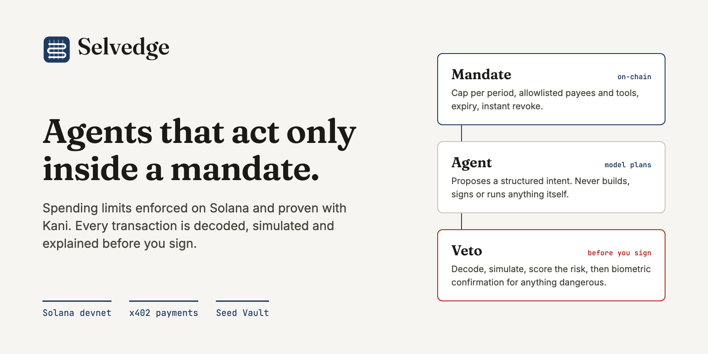

<p align="center">
  
</p>

# Selvedge

Selvedge is an agent platform for Solana Mobile where every agent acts only within an on-chain, formally checked mandate, and a security agent can revoke it. An agent that is tricked, hijacked or simply wrong cannot spend more than its owner allowed, because the limit is held by a Solana program and not by the model.

- Live dashboard (no login): https://selvedge-dashboard.vercel.app
- Solana devnet program: `DDorK5hW2iufBzDi3mmpuiFW2mZT57jGFE2jewmp7pxd`
- Licence: MIT

## What it does

1. **Mandates.** The owner creates a `Mandate` account per agent: spending cap per period, allowed payees, allowed tools, allowed token program, expiry, a nonce and a kill switch. The mandate account is the SPL token delegate of the owner's token account, so the program is the only way for the agent to move funds.
2. **Three gates.** Engine policy pre-check (fast feedback, mirrors the program), the mandate program (the authority), and on Android a biometric confirmation before anything the risk engine marks as dangerous is signed. Compromising the model defeats none of them.
3. **Paid agents over x402.** The studio agent asks for a media or document job, the studio quotes a deterministic price, and the agent pays through the x402 gateway. The payment is a `spend` on the mandate, settled by a self-hosted facilitator.
4. **Security agent.** It reads the containment log, and after a high-severity refusal or repeated refusals it revokes the mandate with its own authority key.
5. **Transaction review.** A TypeScript engine (and an identical Kotlin engine) decodes legacy and v0 transactions, simulates them, applies deterministic risk rules and explains the result in plain English.

## What existed before the hackathon, and what was built here

- **Existed before and was reworked:** the media engine behind the studio service (`services/studio`) comes from the owner's own project Atelier (validated spec, deterministic operation catalogue, recipes, caching). It was copied, renamed, pruned and relicensed MIT; no Atelier server is called. The HTTP service, pricing table, generators, director and job manager were written during the hackathon. Details and scan evidence: [docs/PROVENANCE.md](docs/PROVENANCE.md).
- **Built during the hackathon:** everything else. The mandate program and its proofs, the TypeScript SDK and engine, the x402 gateway, the agent runtime, the dashboard, the Android app, the Kotlin engine, the brand, the conformance vectors and the devnet evidence below.

## Architecture

```
 owner / Android app ──signs──▶ Solana devnet ◀──reads── dashboard (Next.js)
        ▲                          │
        │ biometric veto           │ mandate PDA = SPL delegate
        │                          ▼
 packages/engine ◀── agent runtime ──▶ programs/mandate (Anchor, Kani-checked logic/)
 decode · simulate        │  tools, spend gate,        ▲
 risk · policy mirror     │  security agent            │ spend CPI (transfer_checked)
                          ▼                            │
                 packages/paid-gateway ── x402 ── facilitator (smart-wallet path)
                          │
                          ▼
                 services/studio (validated specs, deterministic ops, priced in micro-USDC)
```

More: [docs/ARCHITECTURE.md](docs/ARCHITECTURE.md), [docs/THREAT-MODEL.md](docs/THREAT-MODEL.md), [docs/API.md](docs/API.md), [docs/DECISIONS.md](docs/DECISIONS.md).

## Verified on Solana devnet

Every signature below is checked against devnet by `pnpm verify:evidence`.

Deployment: program `DDorK5hW2iufBzDi3mmpuiFW2mZT57jGFE2jewmp7pxd`, upgrade authority the owner wallet `9pD9m3hz7GoNXWrtR5h3ZzK8Kr7ZhsDmy7eXbVxcQUKx`, deployed in slot 525627044, transaction [`4jzVfdb1irp4oF9VmMYTnfAevSXgADYRSc4gAV2xvhuC9QeWPmvKaLtJRB7iFPgcZuUMNyoiySXK64nLqxUCPb7j`](https://explorer.solana.com/tx/4jzVfdb1irp4oF9VmMYTnfAevSXgADYRSc4gAV2xvhuC9QeWPmvKaLtJRB7iFPgcZuUMNyoiySXK64nLqxUCPb7j?cluster=devnet).

The payment asset is a 6-decimal test mint created for this project (`CcamYMVfgtUQvsmxKtz1faJqPKCGN2vtnfR6bUWWCxvQ`), not Circle USDC; amounts are written micro-USDC because the unit matches (decision 36).

### Mandate scenarios (mandate `G9Z8GYhyYGe5mZ3yzNbg4rMcbzQRiPULaW9qpiuJdX9D`, cap 5,000,000 per day)

| Scenario | Result | Transaction |
|---|---|---|
| Create mandate and delegate tokens | succeeded | `irryXzE4zwd9rKhmn7GbC3GKHAYUxHc7wkdTEsbc93U5Xe4arpt1gBUnwiepVAJi6s18SRgeApdBVa7YYj1oUM8` |
| Spend 2,000,000 within the cap | succeeded | `zjnsboZtigXhhCSkTUbXQkCyMo9F8PssUWnKHCT4N9YwoAZmtJVqC5vG5AZRuz3ebFXZHsEPJE4pRs7eT3JVdru` |
| Spend 4,000,000 (would pass the cap) | refused, `CapExceeded` (6008) | `3QrWYzGDie47udqniAaoExtbQ1Lpvz2RMCyLut2ZHU99beqHE6Luyfky4q1EFDyRbPHM4reJEaKpqX9pbsWK6QKi` |
| Tool outside the allowlist | refused, `ToolNotAllowed` (6007) | `2hhJJ4LN9rZUQWHpA2AwhgS9piGskPUh8Ux1HHkDbVY86Yb3GT9sY6JfSKNFFSLmWi4BWLe6jrtetLnda1ArguLX` |
| Replay of a used nonce | refused, `StaleNonce` (6003) | `gdbjM1NbJMVB9r7kZDTFzWVbUyg2jeNxbwUDF8mmjsQk3ZeqfnTT3wA9tTd1htLWxLC5BzpXs3ZDUtAjAZApVyz` |
| Security authority revokes | succeeded | `2EUV4yYrRVGiysE6Ybodo9DM6xKCNqtEZBLWAndMT6gtFWjGqzsnfApDLbXctSwKwa9ZtUwoFdTdWxbdsAfPU4qc` |
| Spend after revocation | refused, `Revoked` (6000) | `fHfKaELYGx89fmckfpnoGT8kWobMcQ9P2NBBUt1CfTFuvpgCRS4NDs76LCeDAek4XrNfuK8vm1oHA1gZFgPy3yM` |

Refused spends are real transactions that failed in the program (the script sends them with preflight off so they land on chain and can be inspected).

### Agent run (script `packages/agent-runtime/scripts/devnetAgentRun.ts`, 2026-11-24)

| Run | Model | Outcome |
|---|---|---|
| Studio agent pays an x402 quote of 62,000 micro-USDC | Vultr Serverless Inference `glm-5.3-flash` | settled as a `spend` on mandate `HDuEGxujDAbpBLBMRAisuLawC4PLoFAszMoqfDQ9gWc2` by the facilitator fee payer, transaction `2jmf9MnV5bZHekDQtAbQi5scV248pTYqPVHc2biLnojjYVExkzrotRed24gti1a1LrsSZ6EHDMS1Gsa1LgfmB4Ks`; the studio job succeeded and produced a `.pptx` |
| Injected instruction, engine pre-check disabled | scripted model that obeys the injection | refused by the mandate program, `PayeeNotAllowed`, transaction `36RypxxEiK6LqetzAMrbGSeptL1ALHMPk9VL4ZwNiQvydMnd8FywbgVW7gxViwKZN8jPDMTdSTDucyXH8iJU77p`; security agent revoked in `4b74EvXf9tYSzsoNzm4rL51AyBEqkKCxM1BFp1bu16fpcvAD9ZroH5DzPSqN9bPiWaH3v9UQaW6f8bkPgxKJNKxu` |
| Injected instruction, full gates | scripted model that obeys the injection | refused by the engine policy gate before any transaction; security agent revoked in `5UP4BWZbC6r8xwACJg6VAWbNymwXLp6hJ2wWrNHHJxtTJgui17e9FgbNCHo2UqaWHgKXfHZH9VGCQmUftAVH49dE` |

What the adversarial runs are and are not: the "compromised" model is scripted so that it always obeys the injected note, and the note is appended by a wrapper around a real `read_job_result` call. They show that the gates hold when the model is fully compromised. They do not measure how often a real model falls for an injection. The third gate (biometric) is exercised in the Android tests and in the runtime's unit tests with a simulated owner, not in these devnet runs. Full record: [docs/devnet-agent-run.json](docs/devnet-agent-run.json), [docs/devnet-scenarios.json](docs/devnet-scenarios.json).

## Formal verification

Ten Kani 0.68.0 harnesses prove the policy logic that ships in the program (`programs/mandate/src/logic`, compiled into the proof crate with `#[path]`): spending never exceeds the cap, a revoked or expired mandate authorizes nothing, no panics or overflows, rollover never resets spend inside a period, allowlists are required, and only the owner (or security authority for revoke) changes limits. Bounds and assumptions are written down in [docs/VERIFICATION.md](docs/VERIFICATION.md). A Certora Solana Prover rule crate builds, but the prover run needs a Certora account key and was not executed (see [docs/BLOCKED.md](docs/BLOCKED.md)); nothing is claimed as proved by Certora.

## Run it

Requirements: Node 24.10 or later, pnpm 10.32.1, Rust 1.99.1 with the Solana and Anchor toolchain, Python 3.12 or 3.13 with `uv`, `ffmpeg`. Copy `.env.example` and fill it; keys live in untracked files under `keys/`.

```bash
pnpm install --frozen-lockfile
pnpm test                          # engine, sdk, gateway, runtime, dashboard unit tests
pnpm verify:evidence               # re-checks every signature in this README against devnet
cargo test -p selvedge-mandate     # 37 program tests in LiteSVM (builds target/deploy/selvedge_mandate.so first)
pnpm verify:proofs                 # the ten Kani harnesses (cargo-kani 0.68.0)
(cd services/studio && uv sync && uv run pytest)
```

Live devnet run (needs funded keys and the studio service running):

```bash
pnpm --filter @selvedge/agent-runtime exec tsx scripts/setupDevnet.ts      # test mint, funded accounts
(cd services/studio && uv run python -m selvedge_studio serve)
pnpm --filter @selvedge/agent-runtime exec tsx scripts/devnetAgentRun.ts   # x402 payment and containment runs
```

Dashboard locally: `pnpm --filter @selvedge/web dev`.

## Verify on chain yourself

- Program: `solana program show DDorK5hW2iufBzDi3mmpuiFW2mZT57jGFE2jewmp7pxd --url devnet`
- Any transaction above: `solana confirm -v <signature> --url devnet`, or open it in the explorer with `?cluster=devnet`.
- Mandate state: open `https://selvedge-dashboard.vercel.app/mandates/<mandate address>`.

## Repository layout

| Path | Contents |
|---|---|
| `programs/mandate` | Anchor program, pure policy logic, LiteSVM tests, Kani proofs, Certora rule crate |
| `packages/engine` | decoder, simulator client, risk rules, policy mirror, schemas |
| `packages/sdk` | typed client for the mandate program |
| `packages/paid-gateway` | x402 resource server and in-process facilitator |
| `packages/agent-runtime` | model adapters, tools, spend gate, security agent, adversarial tests, devnet scripts |
| `services/studio` | the ported and reworked media engine and its paid HTTP service |
| `apps/web` | Next.js dashboard |
| `apps/android` | Kotlin engine and Compose wallet app |
| `vectors` | conformance vectors shared by the TypeScript and Kotlin engines |
| `demo` | voice-over script and film builders for the demo video |

## Known limits

- Devnet only. The mandate program has not been audited. The upgrade authority is the owner's wallet.
- The program supports SPL Token, not Token-2022 (decision 34).
- Selvedge on Android is a Mobile Wallet Adapter wallet. It cannot intercept another wallet's Seed Vault prompt; that is a platform limit (see [docs/RESEARCH.md](docs/RESEARCH.md)).
- The studio's LibreOffice-based operations are not offered when LibreOffice is not installed, which is the case on the machine that produced the evidence.
- The dashboard shows the recorded devnet containment run unless `SELVEDGE_RUNTIME_URL` points at a live runtime.
